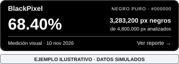

# BlackPixel

BlackPixel analiza qué porcentaje de una página web está compuesto por píxeles de negro puro (`#000000`) y genera un **distintivo para colocar en su footer**, acompañado de evidencia visual consultable.

Es una herramienta de línea de comandos en Node.js. Usa Chromium mediante Playwright para capturar la página y pngjs para analizar sus píxeles. El distintivo se publica como un SVG estático con un enlace al reporte.

> BlackPixel mide presencia visual de negro puro. No mide consumo eléctrico, ahorro energético ni emisiones de CO₂, y no constituye una certificación ambiental. Los resultados corresponden a una URL, una captura de escritorio y una fecha.

## Vista previa del distintivo



**Ejemplo ilustrativo con datos simulados:** 68.40 % de negro puro; 3,283,200 píxeles negros de 4,800,000 analizados. Cada análisis genera este mismo diseño con los resultados y la fecha de la página medida.

El distintivo real se crea en `reports/<id-pagina>/badge.svg`. Al colocarlo en un sitio, el visitante puede hacer clic para consultar el reporte con su URL, fecha y capturas.

### Ejemplo del código para el footer

El siguiente fragmento muestra la estructura. Para tu sitio, copia las direcciones exactas desde `insertar.html`, generado al ejecutar el análisis con `--public-base`. `ID-DE-LA-PAGINA` representa la carpeta que crea el analizador.

```html
<a data-blackpixel-badge
   href="https://tu-sitio.com/blackpixel/ID-DE-LA-PAGINA/reporte.html"
   target="_blank" rel="noopener noreferrer" referrerpolicy="no-referrer"
   style="display:inline-block;max-width:100%">
  
</a>
```

Para generar los archivos y el código de instalación:

```bash
npm run analyze -- https://tu-sitio.com --public-base https://tu-sitio.com/blackpixel/
```

Después publica el contenido de `reports/` en la carpeta indicada y pega el código de `insertar.html` en el footer. El comando prepara los archivos y enlaces; la subida al hosting se realiza en el paso de publicación descrito abajo.

## Actualización de seguridad 1.1.1

Se sustituyen las bibliotecas internas de captura y PNG para retirar dependencias con alertas conocidas, conservando los comandos, el diseño del distintivo, el conteo exacto y las rutas de publicación. Los reportes bloquean scripts, el footer evita enviar la URL visitante por Referer y las capturas tienen límites de tamaño y tiempo. El navegador actualizado puede producir diferencias de renderizado en páginas dinámicas.

## Novedades de la versión 1.1

- Distintivo SVG con porcentaje, cantidad de píxeles negros y fecha de medición.
- Código HTML listo para copiar cuando se indica la dirección de publicación.
- Reporte y datos JSON con URL, método, versión, dimensiones y evidencia visual.
- Resultados separados por URL completa e historial de mediciones conservado.
- Direcciones estables para actualizar el distintivo sin cambiar el código del footer.
- Exclusión del propio distintivo en futuras mediciones mediante `data-blackpixel-badge`.
- Pruebas automáticas de conteo, publicación e instalación.

## Beneficios

- **Comunicación concreta:** permite compartir cuánto negro puro tiene una página.
- **Evidencia consultable:** el visitante puede revisar el resultado, la fecha y las capturas.
- **Carga pequeña:** el SVG utiliza texto y formas, sin fuentes externas ni JavaScript en el sitio del usuario.
- **Trabajo por análisis:** visitar el distintivo carga archivos guardados; no abre el navegador ni vuelve a medir.
- **Actualizaciones sencillas:** una nueva medición publicada actualiza las rutas estables y conserva la evidencia anterior.

## Instalación

Requisitos: Node.js 20 o superior y npm. Playwright descarga un Chromium compatible durante la instalación. En Linux, si faltan bibliotecas del sistema, ejecuta `npx --no-install playwright-core install-deps chromium` (puede solicitar permisos de administrador).

```bash
git clone https://github.com/Interdato-SostenibilidadDigital/BlackPixel.git
cd BlackPixel
npm ci
```

## Analizar una página

```bash
npm run analyze -- https://tu-sitio.com
```

También puedes ejecutar el script directamente:

```bash
node black-pixel-analyzer.js https://tu-sitio.com
```

La consola indica dónde abrir `reporte.html` e `insertar.html`. Sin una dirección pública se genera una vista previa local del distintivo.

## Publicar el distintivo en un sitio web

### 1. Indica dónde alojarás los resultados

```bash
npm run analyze -- https://tu-sitio.com/productos --public-base https://tu-sitio.com/blackpixel/
```

`--public-base` es la URL pública de la carpeta que contendrá **el contenido de `reports/`**. Puede estar en el mismo dominio o en otro alojamiento estático. Esta opción construye los enlaces; la subida al hosting se realiza por separado.

### 2. Sube los resultados

Copia el contenido de `reports/` a la ubicación indicada, conservando los nombres y las subcarpetas. Por ejemplo, la carpeta `<id-pagina>/` quedará disponible en `https://tu-sitio.com/blackpixel/<id-pagina>/`.

Configura el hosting para servir SVG como `image/svg+xml`, HTML como `text/html` y JSON como `application/json`. Puedes usar tu hosting existente: la publicación consiste en archivos estáticos.

### 3. Copia el código generado

Abre `reports/<id-pagina>/insertar.html`. Copia el fragmento que contiene el enlace y la imagen, y pégalo en el footer o en un bloque de HTML personalizado **de la página analizada**.

El código incluye texto alternativo, dimensiones reservadas, carga diferida y el atributo `data-blackpixel-badge`. Conserva este atributo para que el distintivo quede fuera de la siguiente medición.

### 4. Comprueba la instalación

Abre la página: debe aparecer el porcentaje y la cantidad de píxeles negros. Al hacer clic, debe abrirse el reporte con su fecha y capturas. Las direcciones de ese reporte y de sus imágenes deben ser accesibles públicamente.

### 5. Actualiza cuando cambie la página

Repite el mismo comando y vuelve a publicar los archivos. Las rutas estables `badge.svg` y `reporte.html` reflejan la nueva medición; el código del footer permanece válido.

El porcentaje no se actualiza por sí solo al editar el sitio. Se actualiza después de analizar y publicar de nuevo. Configura el hosting para revalidar SVG, HTML y JSON de las rutas estables (por ejemplo, con `Cache-Control: no-cache`) y evitar que una caché muestre datos anteriores.

## Qué se genera

Cada URL obtiene una carpeta con un identificador derivado de su dirección normalizada. Dentro se conserva una subcarpeta fechada por cada medición.

| Ruta dentro de `reports/<id-pagina>/` | Contenido |
| --- | --- |
| `badge.svg` | Distintivo de la última medición completada. |
| `reporte.html` | Reporte estable que muestra la última medición. |
| `resultado.json` | Datos de la última medición, incluida su dirección de evidencia histórica. |
| `insertar.html` | Vista previa e instrucciones con el código de instalación. |
| `<id-medicion>/reporte.html` | Reporte de esa medición concreta. |
| `<id-medicion>/resultado.json` | Métricas y método de esa medición. |
| `<id-medicion>/badge.svg` | Distintivo correspondiente a esa fecha. |
| `<id-medicion>/captura.png` | Captura original completa. |
| `<id-medicion>/captura-marcada.png` | Captura con los píxeles negros contabilizados marcados en fucsia. |
| `<id-medicion>/mapa-negro.png` | Mapa: fucsia = negro contabilizado; azul = área del distintivo excluida; gris = otros píxeles. |

Las mediciones anteriores no se eliminan. Al publicar una actualización conserva también sus carpetas, para que los enlaces de evidencia ya compartidos continúen funcionando. El historial ocupa espacio en proporción al tamaño y cantidad de capturas.

**Cambio respecto a la versión 1.0:** los reportes antiguos se conservan en su ubicación original, pero no se migran al nuevo esquema. Ejecuta un nuevo análisis para obtener el distintivo y las nuevas rutas.

## Medición por página

Cada URL tiene su propio resultado. `/`, `/productos` y `/contacto` se analizan por separado. También se distinguen HTTP/HTTPS, rutas, barras finales y parámetros de consulta. Los fragmentos como `#footer` se omiten porque identifican una posición dentro del mismo documento.

El reporte registra la URL solicitada y la URL final después de redirecciones. La carpeta se identifica a partir de la URL solicitada.

Un distintivo de una página no representa automáticamente al dominio entero. Para mostrar resultados de distintas páginas, analiza cada URL y utiliza el fragmento correspondiente en cada una. Un footer global con el mismo código seguirá mostrando el resultado de la URL que se analizó.

## Método y alcance

1. Abre la URL con Chromium y Playwright en un viewport de **1200 × 800 píxeles CSS**, con escala de captura 1.
2. Recorre la página para activar contenido diferido.
3. Oculta elementos flotantes `fixed` o `sticky`, salvo ciertas barras superiores y el distintivo identificado.
4. Captura por secciones y las une en una imagen vertical.
5. Identifica los rectángulos visibles de elementos con `data-blackpixel-badge` y excluye sus áreas del conteo.
6. Cuenta píxeles cuyo RGB es exactamente `(0, 0, 0)`.

```text
píxeles analizados = píxeles capturados − píxeles excluidos
porcentaje de negro puro = píxeles negros / píxeles analizados × 100
```

El JSON conserva las cantidades sin redondear y el porcentaje completo. El SVG y el reporte muestran el porcentaje con dos decimales. La cantidad corresponde a píxeles de la captura analizada, no al número de píxeles físicos de un dispositivo del visitante.

## Semáforo

Los umbrales son criterios internos de comunicación del proyecto, no una escala energética validada.

| Porcentaje de negro puro | Estado | Lectura |
| --- | --- | --- |
| 66 % o más | VERDE | Alta presencia de negro puro. |
| Desde 33 % hasta menos de 66 % | AMARILLO | Presencia media de negro puro. |
| Menos de 33 % | ROJO | Baja presencia de negro puro. |

El distintivo comunica la métrica y su fecha; el semáforo y las recomendaciones se consultan en el reporte.

## Opciones

| Opción | Uso |
| --- | --- |
| `<url>` | Una URL HTTP o HTTPS por ejecución, sin credenciales. |
| `--public-base <url>` | Carpeta pública de los resultados; sin consulta ni fragmento. |
| `--max-pixels <entero>` | Máximo de píxeles capturados: 50,000,000 por defecto; admite hasta 100,000,000. Superar el límite detiene el análisis. |
| `--output-dir <carpeta>` | Carpeta local de salida. Predeterminada: `reports/`. |
| `--help` | Muestra la ayuda. |

```bash
npm run analyze -- https://tu-sitio.com/contacto --public-base https://evidencia.tu-sitio.com/blackpixel/ --output-dir reports
```

## Pruebas

```bash
npm test
```

Las pruebas de integración usan un servidor local y el navegador Chromium instalado por Playwright. Verifican cantidades conocidas de negro, exclusión de distintivos, conservación del historial, separación de URLs, generación de enlaces e instalación del SVG en el navegador.

Puedes ejecutar cada grupo por separado con `npm run test:unit` o `npm run test:integration`.

## Limitaciones y uso responsable

- Solo se cuenta negro exacto; grises como `#111111` no cuentan.
- El resultado depende del viewport, contenido dinámico, anuncios, cookies, animaciones y redirecciones.
- Es una captura de escritorio en una sesión nueva; no representa todas las variantes móviles o personalizadas.
- La captura por secciones puede repetir barras superiores conservadas u otros elementos que cambien con el scroll.
- Cada análisis dispone de 120 segundos después de iniciar el navegador. El recorrido de carga diferida se detiene con error después de 60 segundos. No se publica una medición parcial al superar estos límites.
- Sitios con scroll infinito, contenido virtualizado, bloqueos a navegadores automatizados o páginas muy grandes pueden requerir adaptaciones.
- El distintivo prueba qué resultado generó el analizador y permite revisar su evidencia; los archivos estáticos son editables y no cuentan con firma criptográfica ni verificación independiente.
- Utiliza expresiones como **“Presencia de negro puro medida con BlackPixel”** y acompáñalas de la fecha y la URL.
- La carpeta `reports/` está ignorada por git. Publicar el código del repositorio no publica los resultados de los análisis.

## Contexto de sostenibilidad digital

El proyecto busca facilitar la observación y comunicación de una característica del diseño que puede ser relevante para pantallas OLED/AMOLED. En ellas, la relación entre color y energía difiere de las pantallas LCD con retroiluminación. El porcentaje de negro, por sí solo, no permite cuantificar ahorro: hacen falta mediciones del dispositivo, brillo, contenido y uso.

## Referencias

- Dash, P. y Hu, Y. C. (2021). *How much battery does dark mode save? An Accurate OLED Display Power Profiler for Modern Smartphones*. ACM MobiSys. https://doi.org/10.1145/3458864.3467682
- Purdue University: [resumen de la investigación sobre modo oscuro y pantallas OLED](https://www.purdue.edu/newsroom/archive/releases/2021/Q3/dark-mode-may-not-save-your-phones-battery-life-as-much-as-you-think%2C-but-there-are-a-few-silver-linings.html).
- MDN: [incluir imágenes SVG en HTML](https://developer.mozilla.org/en-US/docs/Learn_web_development/Core/Structuring_content/Including_vector_graphics_in_HTML).

## Seguridad y mantenimiento

Consulta la [Política de seguridad](SECURITY.md) para reportar vulnerabilidades y conocer el alcance de los controles automáticos.
